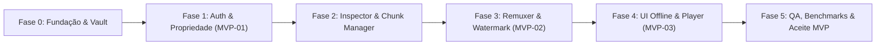

# Plano de Implementação e Roadmap (MVP) — Nano Video Downloader

**Documentos de Referência:**
* [nano_video_downloader_prd.md](./nano_video_downloader_prd.md)
* [nano_video_downloader_spec.md](./nano_video_downloader_spec.md)
* [nano_video_downloader_sdd.md](./nano_video_downloader_sdd.md)

**Objetivo:** Entregar a versão `1.0.0` (MVP) atendendo integralmente aos requisitos `RF-01`–`RF-13`, `RNF-01`–`RNF-05` e aos 3 critérios de aceite do MVP (`MVP-01`, `MVP-02`, `MVP-03`).

---

## Visão Geral das Fases

---

## Fase 0 — Fundação, Runtime e Antigravity Secure Vault
**Meta:** Estruturar a base da aplicação desktop, persistência SQLite, criptografia do SO e regras de organização de arquivos.

- [x] **T0.1 — Setup do Projeto e IPC Bridge**
  - Inicializar estrutura em camadas (`UI Engine`, `IPC / Internal Bridge`, `Backend Runtime`, `Secure Vault`) com canal Request/Response e Pub/Sub tipado.
  - **Ref:** SDD Seção 1 e 4.
- [x] **T0.2 — Esquema SQLite Encapsulado (`SecureVaultManager`)**
  - Criar banco `library.db` com `WAL` e `foreign_keys = ON`, implementando todas as tabelas: `accounts`, `courses`, `modules`, `lessons`, `download_jobs`, `segment_checkpoints`, `playback_progress` e `audit_watermarks`.
  - **Ref:** SDD Seção 3.2.
- [x] **T0.3 — Cofre de Segredos do SO e Criptografia AES-256-GCM**
  - Integrar armazenamento nativo (Windows Credential Manager / macOS Keychain / Linux Secret Service) para tokens e chave local, além de assinatura vinculada ao `machine_id` para staging `.antigravity-media`.
  - **Ref:** `RNF-01`; SDD Seção 2.6 e 6.1.
- [x] **T0.4 — Sanitizador Determinístico de Caminhos**
  - Implementar gerador de paths `/{Nome_Curso}/{Modulo_XX}/{Aula_YY - Titulo}.mp4` com padding de 2 dígitos (`01`, `02`), remoção de caracteres inválidos Windows/POSIX e truncamento seguro de comprimento máximo.
  - **Ref:** `RF-11`; SPEC Seção 2.4.

---

## Fase 1 — Autenticação Isolada (`WebBridge`) e Verificação de Propriedade (`MVP-01`)
**Meta:** Permitir conexão segura na Hotmart e Kiwify, validar compra ativa antes de listar/baixar e revogar acessos reembolsados/expirados.

- [x] **T1.1 — Contrato `IPlatformAdapter` e `AuthManager`**
  - Definir interface padrão de adaptadores e implementar `Antigravity WebBridge` com janela/partition isolada por conta, sem logar ou persistir credenciais em texto plano.
  - **Ref:** `RF-01`, `RF-02`; SDD Seção 2.1 e 2.2.
- [x] **T1.2 — Adaptador Hotmart (Auth, Compras e Catálogo)**
  - Implementar fluxos de captura de sessão, consulta de titularidade (`/my-courses`, `/purchases` ou equivalentes) e extração da árvore de módulos/aulas do Club Hotmart.
  - **Ref:** `RF-03`, `RF-05`; SPEC Seção 4.1.
- [x] **T1.3 — Adaptador Kiwify (Auth, Compras e Catálogo)**
  - Implementar fluxos de captura de sessão, consulta de titularidade e extração da árvore de módulos/aulas do Kiwify Members.
  - **Ref:** `RF-03`, `RF-05`; SPEC Seção 4.1.
- [x] **T1.4 — `OwnershipVerifier` e Revogação Imediata**
  - Validar status `COMPLETED`/`ACTIVE` antes de listagem e antes de cada download/retomada. Ao detectar `EXPIRED`, `REFUNDED` ou `CANCELED`, marcar jobs como `REVOKED`, descartar buffers parciais e emitir `ownership:revoked`.
  - **Ref:** `RF-03`, `RF-04`; SDD Seção 2.2.
- [x] **T1.5 — `CatalogCrawler` e Estados de Disponibilidade**
  - Persistir hierarquia `Curso -> Módulos -> Aulas` no SQLite classificando corretamente aulas `AVAILABLE`, `LOCKED_DRIP` e `NO_VIDEO`.
  - **Ref:** `RF-05`; SDD Seção 3.2.

---

## Fase 2 — Inspeção de Mídia, Fila e Download Resiliente
**Meta:** Detectar manifestos HLS/DASH/CDN, permitir escolha de resolução e baixar segmentos em paralelo com controle de banda e retomada exata.

- [x] **T2.1 — `MediaStreamInspector` (HLS, DASH e CDN Direta)**
  - Implementar `HlsManifestParser` (`.m3u8` muxado e áudio separado + detecção `#EXT-X-KEY`), `DashManifestParser` (`.mpd`) e `DirectRangeInspector` (`Accept-Ranges: bytes`). Sinalizar `DRM_UNSUPPORTED` sem tentar quebra de DRM comercial externo.
  - **Ref:** `RF-06`, `RNF-02`; SPEC Seção 4.2; SDD Seção 2.3.
- [x] **T2.2 — `ResolutionSelector` e Fallback**
  - Permitir seleção de resolução (`1080p`, `720p`, `480p`) por aula, lote ou padrão global com fallback determinístico quando a resolução desejada não estiver no manifesto.
  - **Ref:** `RF-07`; SPEC Seção 2.2.
- [x] **T2.3 — `QueueAndChunkManager` e Máquina de Estados**
  - Implementar fila com estados `QUEUED`, `VERIFYING_OWNERSHIP`, `INSPECTING_MEDIA`, `DOWNLOADING`, `PAUSED`, `REMUXING`, `COMPLETED`, `FAILED`, `REVOKED`, `CANCELED`, suportando enfileiramento por aula, módulo ou curso completo e ações `Pause`/`Resume`/`Cancel`.
  - **Ref:** `RF-08`, `RF-10`; SDD Seção 2.4.
- [x] **T2.4 — Pool Concorrente, Retry e Checkpointing Atômico**
  - Limitar concorrência (<= 2 aulas simultâneas, <= 4 chunks/aula), aplicar backoff exponencial + jitter (até 5 tentativas), renovar Signed URLs expiradas na retomada e gravar `.part` -> `.seg` com commit em `segment_checkpoints`.
  - **Ref:** `RF-08`, `RNF-04`; SDD Seção 2.4 e 5.2.
- [x] **T2.5 — `BandwidthLimiter` (Token Bucket) e Telemetria IPC**
  - Implementar limitador global de banda com efeito em `< 1s` e emitir eventos `queue:jobProgress` (<= 500ms) e `queue:moduleProgress`.
  - **Ref:** `RF-10`, `RNF-05`; SDD Seção 2.4 e 4.2.

---

## Fase 3 — Decifração, Remuxing MP4 e Marca d'Água (`MVP-02`)
**Meta:** Unir segmentos em `.mp4` sincronizado respeitando limites de CPU/RAM e inserir marca d'água de titularidade.

- [x] **T3.1 — `DecryptionAndRemuxer` em Streaming**
  - Implementar remuxing por cópia de stream (sem re-encoding), decifração autorizada em memória para HLS AES-128 com chave de sessão e realocação do átomo `moov` (`faststart`).
  - **Ref:** `RF-09`; SDD Seção 1.3 e 2.5.
- [x] **T3.2 — Gestão de CPU (<= 60% idle) e Liberação de RAM**
  - Executar worker de remux serializado com prioridade reduzida (`BELOW_NORMAL` / `nice +10`), buffers fixos de leitura e fechamento/liberação explícita de memória e descritores logo após cada aula.
  - **Ref:** `RNF-03`; SDD Seção 7.
- [x] **T3.3 — Injeção de Marca d'Água Forense e Promoção Atômica**
  - Gravar metadados de titularidade no container MP4 (`antigravity_owner_hash`, `antigravity_platform`, `antigravity_purchase_ref`, `antigravity_issued_at`), registrar em `audit_watermarks`, validar integridade A/V, mover atomicamente para o destino final e apagar staging `.antigravity-media`.
  - **Ref:** `RNF-02`, `RF-11`; SDD Seção 2.5 e 6.2.

---

## Fase 4 — Interface (UI Engine), Biblioteca Offline e Player Nativo (`MVP-03`)
**Meta:** Entregar experiência completa de catálogo, fila em tempo real e reprodução 100% offline.

- [x] **T4.1 — Telas de Conexão de Contas e Catálogo**
  - Construir interface de gerenciamento de contas (Hotmart/Kiwify), disparo do WebBridge, status de sessão e grade/árvore de cursos com seleção por aula/módulo e seletor de resolução.
  - **Ref:** `RF-01`, `RF-05`, `RF-07`, `RF-10`; SPEC Seção 5.1.
- [x] **T4.2 — Tela de Fila de Downloads e Controle de Banda**
  - Exibir progresso individual por aula (`%`, `MB/s`, ETA, segmentos `K/N`) e progresso agregado por módulo/fila, com ações individuais/globais e campo de limite de banda.
  - **Ref:** `RNF-05`, `RF-08`, `RF-10`; SPEC Seção 5.1.
- [x] **T4.3 — Biblioteca Offline Resiliente**
  - Carregar catálogo baixado, metadados, duração e status de conclusão diretamente do SQLite via `catalog:getOffline`, alternando automaticamente para modo offline quando `network:statusChanged` indicar ausência de rede.
  - **Ref:** `RF-12`; SDD Seção 4 e 5.3.
- [x] **T4.4 — Player Nativo Embutido Antigravity**
  - Implementar player local com velocidades (`0.5x` a `2.5x`), atalhos de teclado (`Espaço`/`K`, `J`/`L`/Setas, `M`, `F`, `[`/`]`), salvamento de `last_position_sec` a cada 5s/pause, botão "Próxima Aula" e marcação automática "Assistida" ao atingir `>= 90%` ou fim do vídeo.
  - **Ref:** `RF-13`; SPEC Seção 2.4; SDD Seção 8.

---

## Fase 5 — Verificação, Benchmarks e Aceite do MVP
**Meta:** Validar formalmente todos os critérios de aceite antes de liberar a versão `1.0.0`.

- [x] **T5.1 — Suíte Unitária e de Integração (Mocks)**
  - Cobrir parsers `.m3u8`/`.mpd`, sanitizador de paths, Token Bucket, adaptadores mockados (cenários `ACTIVE`, `COMPLETED`, `REFUNDED`, `EXPIRED`) e verificação de revogação imediata.
  - **Ref:** SPEC Seção 6.2 (`MVP-01`); SDD Seção 9.
- [x] **T5.2 — Teste de Queda no Segmento `145/300` (`RNF-04`)**
  - Simular interrupção de rede exatamente no segmento `145/300`, confirmar preservação dos segmentos `0..144`, retomada a partir do `145` e integridade do `.mp4` final.
  - **Ref:** `RNF-04`; SDD Seção 5.2 e 9.
- [x] **T5.3 — Benchmark de Aula 15 min @ 1080p (`MVP-02`)**
  - Validar download + remuxing de aula de 15 minutos em 1080p medindo CPU (<= 60% idle), retorno da RAM pós-aula (`< +50 MB` residual), ausência de artefatos/dessincronia A/V e presença da marca d'água nos átomos MP4.
  - **Ref:** `RNF-02`, `RNF-03`, PRD Seção 7 (`MVP-02`).
- [x] **T5.4 — Teste E2E em Modo Avião (`MVP-03`)**
  - Verificação automatizada em Electron com rede HTTP/HTTPS bloqueada, carregamento da biblioteca offline via SQLite, streaming local `antigravity-media://` (`206` Byte-Range + `<video>`) e persistência de progresso `"Assistida"`. *(Validação manual adicional com placa de rede física desligada e conta real Hotmart/Kiwify recomendada antes da release.)*
  - **Ref:** `RF-12`, `RF-13`, PRD Seção 7 (`MVP-03`).
