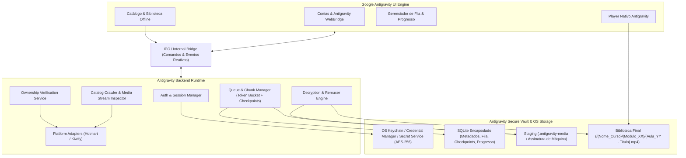
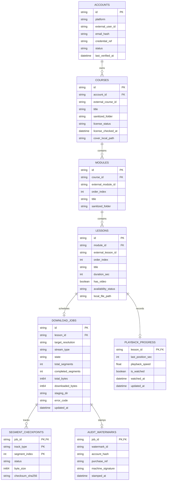
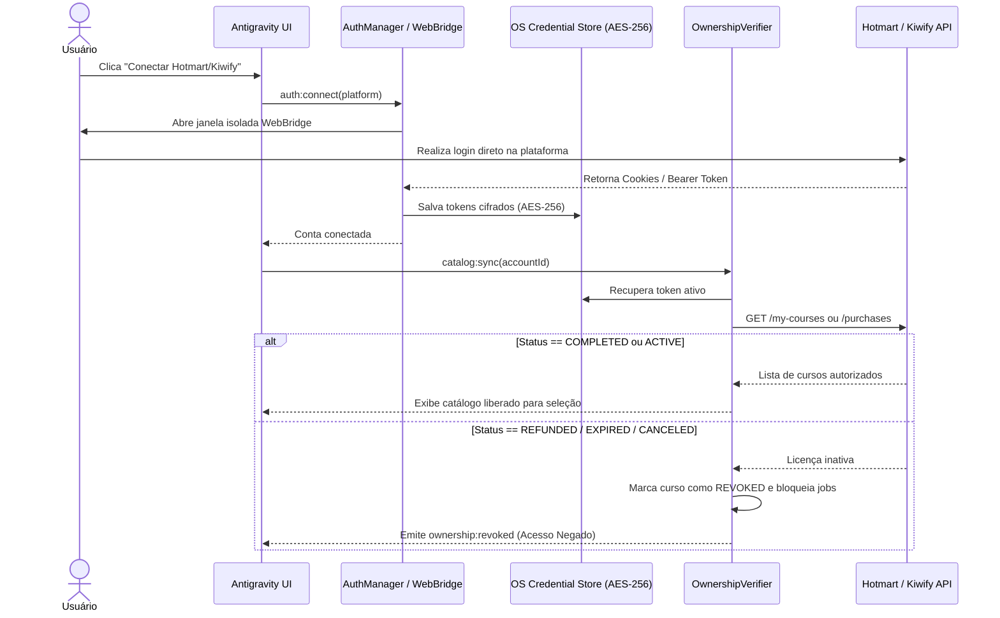
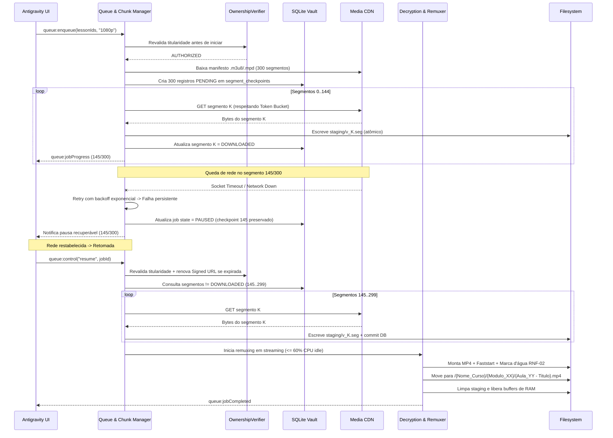

# Software Design Document (SDD) — Nano Video Downloader

**Documentos Relacionados:**
* [nano_video_downloader_prd.md](./nano_video_downloader_prd.md) (Product Requirements Document)
* [nano_video_downloader_spec.md](./nano_video_downloader_spec.md) (Especificação Técnica)

**Versão:** 1.0.0  
**Stack Tecnológica:** Google Antigravity (UI Engine, Backend Runtime, WebBridge, Secure Vault)

---

## 1. Visão Geral da Arquitetura

### 1.1 Estilo Arquitetural
O **Nano Video Downloader** adota uma arquitetura **Desktop Local em Camadas Orientada a Eventos**, executando integralmente na estação do usuário sobre o runtime do **Google Antigravity**. A separação estrita entre a interface (`Antigravity UI Engine`) e o motor de processamento (`Antigravity Backend Runtime`) via `IPC / Internal Bridge` garante:
* Isolamento de credenciais e tokens fora do contexto de renderização da UI.
* Execução assíncrona de downloads e remuxing sem bloqueio da interface gráfica (RNF-05).
* Continuidade operacional da biblioteca e player em modo 100% offline (RF-12, RF-13).

### 1.2 Diagrama de Arquitetura de Componentes



### 1.3 Decisões Arquiteturais (ADRs)

| ID | Decisão | Justificativa |
| :--- | :--- | :--- |
| **ADR-01** | **Remuxing por Cópia de Stream (sem re-encoding)** | Evita transcodificação pesada de vídeo, mantendo fidelidade 1:1 da fonte, garantindo sincronia PTS/DTS e cumprindo RNF-03 (<= 60% CPU idle e rápida liberação de RAM). |
| **ADR-02** | **Padrão Adapter para Plataformas** | Isola particularidades de API/DOM da Hotmart, Kiwify e futuras plataformas atrás de uma interface única `IPlatformAdapter`, facilitando manutenção quando endpoints mudam. |
| **ADR-03** | **Checkpointing Atômico por Segmento no SQLite** | Cada segmento baixado é gravado no staging `.antigravity-media` com hash/tamanho validado e marcado no SQLite em transação atômica, viabilizando retomada exata no segmento `145/300` (RNF-04). |
| **ADR-04** | **Cofre de Segredos Delegado ao SO + AES-256** | Chaves de sessão e segredos não são armazenados em arquivos planos; utilizam o cofre nativo do SO (Credential Manager / Keychain / Secret Service) combinado com AES-256 (RNF-01). |
| **ADR-05** | **Staging Isolado com Promoção Atômica** | Downloads em andamento ficam em `.antigravity-media` e só são movidos para `/{Nome_Curso}/{Modulo_XX}/{Aula_YY - Titulo}.mp4` após remuxing completo e injeção da marca d'água de titularidade (RNF-02). |

---

## 2. Design Detalhado dos Módulos (Backend Runtime)

### 2.1 `AuthManager` & `Antigravity WebBridge`
* **Responsabilidade:** Conduzir autenticação interativa sem acesso a senhas em texto claro (RF-01) e extrair tokens de sessão (RF-02).
* **Design:**
  * Abre uma janela isolada (`WebBridgeSession`) com `partition` dedicado por plataforma/conta.
  * Intercepta apenas eventos de navegação/cabeçalhos de resposta autorizados para capturar cookies `HttpOnly` de sessão ou tokens OAuth/Bearer emitidos após login bem-sucedido.
  * Fecha a janela `WebBridge` imediatamente após captura e persiste o pacote `AuthSessionSecret` cifrado em AES-256 no cofre do SO.

### 2.2 `OwnershipVerifier` & `IPlatformAdapter`
* **Responsabilidade:** Garantir conformidade de titularidade (RF-03, RF-04).
* **Interface do Adaptador:**
  ```typescript
  interface IPlatformAdapter {
    readonly platformId: 'hotmart' | 'kiwify';
    getLoginConfig(): WebBridgeConfig;
    fetchPurchases(session: DecryptedSession): Promise<PurchaseRecord[]>;
    verifyCourseOwnership(session: DecryptedSession, courseExternalId: string): Promise<OwnershipResult>;
    fetchCourseCatalog(session: DecryptedSession, courseExternalId: string): Promise<CourseTree>;
    resolveLessonMedia(session: DecryptedSession, lessonExternalId: string): Promise<MediaDescriptor>;
  }
  ```
* **Política de Revalidação:**
  * `verifyCourseOwnership` consulta `/my-courses`, `/purchases` ou equivalente.
  * Somente `status IN ('COMPLETED', 'ACTIVE')` retorna `AUTHORIZED`.
  * Qualquer resposta `EXPIRED`, `REFUNDED`, `CANCELED` ou HTTP `401/403` de revogação dispara `revokeCourseDownloads(courseId)`, transicionando jobs ativos/pausados para `REVOKED` e limpando buffers `.antigravity-media` incompletos.

### 2.3 `MediaStreamInspector`
* **Responsabilidade:** Interpretar manifestos HLS (`.m3u8`), DASH (`.mpd`) e URLs diretas de CDN (RF-06, RF-07).
* **Componentes Internos:**
  * `HlsManifestParser`: resolve Master Playlist (`#EXT-X-STREAM-INF`), associa faixas de áudio separadas (`#EXT-X-MEDIA:TYPE=AUDIO`), detecta `#EXT-X-KEY` (AES-128) e expande a lista ordenada de segmentos (`0..N-1`).
  * `DashManifestParser`: interpreta XML `.mpd`, extrai `AdaptationSet` de vídeo/áudio e expande `SegmentTemplate` / `SegmentTimeline` / `SegmentList`.
  * `DirectRangeInspector`: envia `HEAD` para verificar `Content-Length` e `Accept-Ranges: bytes`, particionando arquivos grandes em chunks lógicos virtuais (ex.: 2 MB por chunk) para reutilizar o mesmo mecanismo de checkpoint e retomada do `ChunkManager`.
  * `ResolutionSelector`: seleciona a variante correspondente à preferência (`1080p`, `720p`, `480p`) com fallback determinístico.

### 2.4 `QueueAndChunkManager`
* **Responsabilidade:** Orquestrar fila, concorrência, throttling, retries e retomada por segmento (RF-08, RF-10, RNF-04).
* **Máquina de Estados do Job de Download:**
  ```mermaid
  stateDiagram-v2
      [*] --> QUEUED
      QUEUED --> VERIFYING_OWNERSHIP: Worker disponível
      VERIFYING_OWNERSHIP --> REVOKED: Licença Inativa / Reembolsada
      VERIFYING_OWNERSHIP --> INSPECTING_MEDIA: Licença ACTIVE/COMPLETED
      INSPECTING_MEDIA --> DOWNLOADING: Manifesto resolvido (N segmentos)
      DOWNLOADING --> PAUSED: Ação usuário / Erro após max retries
      PAUSED --> VERIFYING_OWNERSHIP: Retomar (Revalida licença + URL)
      DOWNLOADING --> REVOKED: Revogação detectada
      DOWNLOADING --> REMUXING: Todos N segmentos concluídos
      REMUXING --> COMPLETED: MP4 validado + Marca d'água + Movido
      INSPECTING_MEDIA --> FAILED: Mídia incompatível / DRM externo
      REMUXING --> FAILED: Erro de I/O ou container inválido
      PAUSED --> CANCELED: Cancelamento pelo usuário
      QUEUED --> CANCELED: Cancelamento pelo usuário
  ```
* **Algoritmo de Controle de Banda (Token Bucket Global):**
  * Um `BandwidthLimiter` compartilhado entre todos os workers de chunk aloca tokens em bytes/segundo conforme o limite configurado (`bandwidthLimitBytesPerSec`, ou `Infinity`).
  * Streams HTTP leem em fatias (ex.: 16 KB) aguardando permissão assíncrona do bucket, garantindo resposta < 1s a ajustes na UI sem descartar conexões.
* **Resiliência e Retomada (Ex.: Segmento 145/300):**
  * Antes de iniciar o download, o worker consulta `segment_checkpoints` para o `job_id`.
  * Apenas índices com `status != 'DOWNLOADED'` ou cujo arquivo `.seg` falhe na verificação de tamanho/hash são agendados no pool.
  * Segmentos são baixados para `{staging_dir}/{job_id}/v_{index}.seg` (e `a_{index}.seg` quando áudio separado) com escrita em arquivo `.part` seguida de `rename` atômico para `.seg` antes do commit no SQLite.

### 2.5 `DecryptionAndRemuxer`
* **Responsabilidade:** Decifrar segmentos autorizados (quando HLS AES-128 com chave de sessão), unir e remuxar fluxos em `.mp4`, inserir marca d'água e liberar recursos (RF-09, RNF-02, RNF-03).
* **Pipeline em Streaming (Baixo Consumo de RAM):**
  1. Aloca um pipeline incremental (processo worker isolado ou binding nativo de demux/remux com prioridade reduzida / throttle de I/O para respeitar <= 60% CPU idle).
  2. Lê sequencialmente cada segmento `0..N-1` do staging em buffers reutilizáveis de tamanho fixo (sem carregar o vídeo inteiro em RAM).
  3. Se houver chave de transporte autorizada associada ao segmento, aplica decifração em memória no buffer do chunk e zera a chave ao fim da operação.
  4. Escreve o container `.mp4` temporário em `{staging_dir}/{job_id}/output.mp4` com `moov` atom movido para o início (`faststart`) para seek instantâneo no player offline.
  5. Grava átomos de metadados de marca d'água (RNF-02) no container:
     * Título (`©nam`), Curso/Módulo (`©alb`), Comentário/Licença (`©cmt` com payload JSON/assinatura HMAC vinculando `account_hash`, `platform`, `purchase_ref`, `machine_fingerprint_hash`, `timestamp`).
  6. Valida integridade básica do `.mp4` (duração, faixas A/V presentes, ausência de EOF prematuro).
  7. Move atomicamente para o caminho final `/{Nome_Curso}/{Modulo_XX}/{Aula_YY - Titulo}.mp4`.
  8. Remove o diretório temporário `{staging_dir}/{job_id}` e força liberação dos buffers/handles alocados.

### 2.6 `SecureVaultManager`
* **Responsabilidade:** Gerenciar SQLite encapsulado, criptografia AES-256 e assinatura vinculada à máquina local (RNF-01).
* **Assinatura Criptográfica da Máquina Local:**
  * Deriva uma chave de integridade vinculada ao hardware/instalação (`machine_id` do SO + salt gerado na instalação e guardado no Keychain/Credential Manager).
  * Buffers `.antigravity-media` e registros críticos de metadados no SQLite recebem tag HMAC-SHA256 / encriptação AES-256-GCM para impedir adulteração ou reaproveitamento bruto fora da instalação autorizada.

---

## 3. Modelo de Dados e Persistência (SQLite Encapsulado)

### 3.1 Diagrama Entidade-Relacionamento



### 3.2 Esquema SQL (SQLite)

```sql
PRAGMA foreign_keys = ON;
PRAGMA journal_mode = WAL;

CREATE TABLE accounts (
    id TEXT PRIMARY KEY,
    platform TEXT NOT NULL CHECK (platform IN ('hotmart', 'kiwify')),
    external_user_id TEXT NOT NULL,
    email_hash TEXT NOT NULL,
    credential_ref TEXT NOT NULL, -- Chave lógica no Keychain/Credential Manager
    status TEXT NOT NULL CHECK (status IN ('CONNECTED', 'EXPIRED', 'DISCONNECTED')),
    last_verified_at TEXT NOT NULL
);

CREATE TABLE courses (
    id TEXT PRIMARY KEY,
    account_id TEXT NOT NULL REFERENCES accounts(id) ON DELETE CASCADE,
    external_course_id TEXT NOT NULL,
    title TEXT NOT NULL,
    sanitized_folder TEXT NOT NULL,
    license_status TEXT NOT NULL CHECK (license_status IN ('AUTHORIZED', 'REVOKED')),
    license_checked_at TEXT NOT NULL,
    cover_local_path TEXT,
    UNIQUE(account_id, external_course_id)
);

CREATE TABLE modules (
    id TEXT PRIMARY KEY,
    course_id TEXT NOT NULL REFERENCES courses(id) ON DELETE CASCADE,
    external_module_id TEXT NOT NULL,
    order_index INTEGER NOT NULL,
    title TEXT NOT NULL,
    sanitized_folder TEXT NOT NULL,
    UNIQUE(course_id, external_module_id)
);

CREATE TABLE lessons (
    id TEXT PRIMARY KEY,
    module_id TEXT NOT NULL REFERENCES modules(id) ON DELETE CASCADE,
    external_lesson_id TEXT NOT NULL,
    order_index INTEGER NOT NULL,
    title TEXT NOT NULL,
    duration_sec INTEGER DEFAULT 0,
    has_video INTEGER NOT NULL DEFAULT 1,
    availability_status TEXT NOT NULL CHECK (availability_status IN ('AVAILABLE', 'LOCKED_DRIP', 'NO_VIDEO', 'DRM_UNSUPPORTED')),
    local_file_path TEXT,
    UNIQUE(module_id, external_lesson_id)
);

CREATE TABLE download_jobs (
    id TEXT PRIMARY KEY,
    lesson_id TEXT NOT NULL UNIQUE REFERENCES lessons(id) ON DELETE CASCADE,
    target_resolution TEXT NOT NULL,
    stream_type TEXT CHECK (stream_type IN ('HLS', 'DASH', 'DIRECT')),
    state TEXT NOT NULL CHECK (state IN (
        'QUEUED', 'VERIFYING_OWNERSHIP', 'INSPECTING_MEDIA',
        'DOWNLOADING', 'PAUSED', 'REMUXING', 'COMPLETED', 'FAILED', 'REVOKED', 'CANCELED'
    )),
    total_segments INTEGER NOT NULL DEFAULT 0,
    completed_segments INTEGER NOT NULL DEFAULT 0,
    total_bytes INTEGER NOT NULL DEFAULT 0,
    downloaded_bytes INTEGER NOT NULL DEFAULT 0,
    staging_dir TEXT NOT NULL,
    error_code TEXT,
    updated_at TEXT NOT NULL
);

CREATE TABLE segment_checkpoints (
    job_id TEXT NOT NULL REFERENCES download_jobs(id) ON DELETE CASCADE,
    track_type TEXT NOT NULL CHECK (track_type IN ('VIDEO', 'AUDIO', 'MUXED')),
    segment_index INTEGER NOT NULL,
    status TEXT NOT NULL CHECK (status IN ('PENDING', 'DOWNLOADED')),
    byte_size INTEGER NOT NULL DEFAULT 0,
    checksum_sha256 TEXT,
    PRIMARY KEY (job_id, track_type, segment_index)
);

CREATE TABLE playback_progress (
    lesson_id TEXT PRIMARY KEY REFERENCES lessons(id) ON DELETE CASCADE,
    last_position_sec INTEGER NOT NULL DEFAULT 0,
    playback_speed REAL NOT NULL DEFAULT 1.0,
    is_watched INTEGER NOT NULL DEFAULT 0,
    watched_at TEXT,
    updated_at TEXT NOT NULL
);

CREATE TABLE audit_watermarks (
    job_id TEXT PRIMARY KEY REFERENCES download_jobs(id) ON DELETE CASCADE,
    watermark_id TEXT NOT NULL,
    account_hash TEXT NOT NULL,
    purchase_ref TEXT NOT NULL,
    machine_signature TEXT NOT NULL,
    stamped_at TEXT NOT NULL
);

CREATE INDEX idx_jobs_state ON download_jobs(state);
CREATE INDEX idx_checkpoints_pending ON segment_checkpoints(job_id, status);
```

### 3.3 Layout do Sistema de Arquivos
```text
<AntigravityAppData>/
├── vault/
│   ├── library.db                  # SQLite encapsulado
│   └── staging/                    # Área .antigravity-media temporária
│       └── <job_id>.antigravity-media/
│           ├── manifest.lock.json  # Metadados assinados com machine_signature
│           ├── v_0000.seg ... v_0299.seg
│           └── a_0000.seg ... a_0299.seg
└── <BibliotecaConfigurada>/        # Destino estruturado (RF-11)
    └── {Nome_Curso}/
        └── Modulo_01/
            ├── Aula_01 - Introducao.mp4
            └── Aula_02 - Arquitetura.mp4
```

---

## 4. Contratos do IPC / Internal Bridge

A comunicação entre `Antigravity UI Engine` e `Antigravity Backend Runtime` segue o padrão Request/Response para comandos e Pub/Sub para eventos em tempo real.

### 4.1 Comandos (UI -> Backend)

| Canal IPC | Payload de Entrada | Retorno |
| :--- | :--- | :--- |
| `auth:connect` | `{ platform: 'hotmart' \| 'kiwify' }` | `{ accountId, status }` |
| `auth:disconnect` | `{ accountId: string }` | `{ ok: true }` |
| `catalog:sync` | `{ accountId: string }` | `{ courses: CourseSummary[] }` |
| `catalog:getOffline` | `{}` | `{ courses: OfflineCourseTree[] }` |
| `course:getDetails` | `{ courseId: string, forceRemote?: boolean }` | `{ course, modules, lessons }` |
| `queue:enqueue` | `{ lessonIds: string[], resolution: '1080p' \| '720p' \| '480p' }` | `{ enqueuedJobIds: string[], rejected: RejectedItem[] }` |
| `queue:control` | `{ action: 'pause' \| 'resume' \| 'cancel', jobId?: string }` | `{ ok: true }` |
| `queue:setBandwidthLimit` | `{ bytesPerSec: number \| null }` | `{ activeLimit: number \| null }` |
| `player:openLesson` | `{ lessonId: string }` | `{ fileUrl, progress, metadata }` |
| `player:saveProgress` | `{ lessonId: string, positionSec: number, speed: number, forceWatched?: boolean }` | `{ isWatched: boolean }` |

### 4.2 Eventos Reativos (Backend -> UI)

| Evento IPC | Payload | Frequência / Gatilho |
| :--- | :--- | :--- |
| `network:statusChanged` | `{ online: boolean }` | Mudança de conectividade / Modo Avião |
| `ownership:revoked` | `{ courseId: string, reason: string, affectedJobIds: string[] }` | Ao detectar reembolso/expiração (RF-04) |
| `queue:jobProgress` | `{ jobId, lessonId, moduleId, state, completedSegments, totalSegments, bytesPerSec, etaSec, percent }` | Throttled a cada `<= 500ms` durante download/remux (RNF-05) |
| `queue:moduleProgress` | `{ moduleId, completedLessons, totalLessons, overallPercent }` | Atualização agregada por módulo |
| `queue:jobCompleted` | `{ jobId, lessonId, localFilePath }` | Ao finalizar remuxing e mover arquivo |

---

## 5. Diagramas de Sequência Críticos

### 5.1 Autenticação via WebBridge e Verificação de Propriedade



### 5.2 Download Paralelo, Queda no Segmento 145/300 e Remuxing



### 5.3 Reprodução Offline em Modo Avião

```mermaid
sequenceDiagram
    actor User as Usuário
    participant UI as Antigravity UI & Player
    participant Back as Backend Runtime
    participant DB as SQLite Vault
    participant FS as Biblioteca Local (.mp4)

    Note over User,FS: Placa de rede desativada (Modo Avião)
    User->>UI: Abre Nano Video Downloader
    UI->>Back: catalog:getOffline()
    Back->>DB: Lê cursos, módulos, aulas locais e playback_progress
    DB-->>Back: Árvore offline completa
    Back-->>UI: Renderiza biblioteca sem chamadas externas

    User->>UI: Seleciona Aula_01
    UI->>Back: player:openLesson(lessonId)
    Back->>FS: Valida existência e assinatura/integridade local
    Back-->>UI: Retorna caminho local + last_position_sec + playback_speed
    UI->>FS: Stream local direto no Player Nativo (0.5x..2.5x)
    loop A cada 5s ou pause
        UI->>Back: player:saveProgress(lessonId, pos, speed)
        Back->>DB: Atualiza last_position_sec; se pos >= 90% -> is_watched = 1
    end
```

---

## 6. Segurança, Criptografia e Conformidade

### 6.1 Gestão de Segredos e Chaves (RNF-01)
* **Armazenamento no SO:**
  * **Windows:** `Credential Manager` (DPAPI / CredWrite).
  * **macOS:** `Keychain Services`.
  * **Linux:** `Secret Service API` (`libsecret`).
* **Chaves e Cifra:** Todos os payloads de sessão (`cookies`, `access_token`, `refresh_token`) e a chave local do vault são cifrados com **AES-256-GCM** (nonce único por operação e tag de autenticação).

### 6.2 Marca d'Água Forense de Titularidade (RNF-02)
* Em conformidade estrita com os termos de uso e combate à redistribuição não autorizada, cada `.mp4` gerado recebe metadados imutáveis ao nível de container (`udta` / `meta` / `ilst` MP4 atoms):
  * `antigravity_owner_hash`: SHA-256 do e-mail/ID do comprador + salt da plataforma.
  * `antigravity_platform`: `hotmart` ou `kiwify`.
  * `antigravity_purchase_ref`: identificador mascarado/referência da transação validada.
  * `antigravity_issued_at`: timestamp UTC da geração offline.

---

## 7. Performance, Concorrência e Gestão de Recursos (RNF-03)

* **Orçamento de CPU durante Remuxing:**
  * O processo de remuxing executa sem decodificação/re-encoding de frames H.264/H.265/AAC, limitando o trabalho a demux/mux de pacotes comprimidos.
  * Em sistemas multi-core, o worker de remux opera com prioridade de processo baixa (`BELOW_NORMAL` / `nice +10`) e fila serializada de remux (1 remux ativo por vez por padrão), evitando picos acima de 60% de CPU idle mesmo durante downloads paralelos.
* **Ciclo de Vida de Memória RAM:**
  * Cada segmento baixado é transmitido por pipe direto para disco (buffer de leitura <= 64 KB por conexão).
  * O remuxer lê blocos sequenciais de tamanho limitado e fecha explicitamente descritores de arquivo e buffers alocados ao final de cada aula.
* **Pool de Conexões:**
  * Máximo de 2 aulas baixando simultaneamente na fila, com até 4 chunks paralelos por aula (máximo de 8 sockets simultâneos), evitando exaustão de portas e throttling agressivo pelas CDNs.

---

## 8. Design de Interface e Player Nativo (UI Engine)

* **Gerenciamento de Estado Reativo:**
  * Store central dividido em `authSlice`, `catalogSlice`, `queueSlice` (alimentado por `queue:jobProgress` e `queue:moduleProgress`) e `playerSlice`.
  * Detecção passiva de rede (`online`/`offline`) alterna automaticamente a UI para o modo offline sem interromper o player.
* **Player Nativo Antigravity:**
  * Baseado em componente `<video>` acelerado por hardware do runtime Antigravity apontando via protocolo interno seguro para o arquivo `.mp4` local.
  * Barra de controles customizada com seletor de velocidade (`0.5x` a `2.5x`), atalhos globais de teclado dentro da view do player e botão "Próxima Aula" seguindo `modules.order_index` e `lessons.order_index`.

---

## 9. Estratégia de Testes e Verificação

| Camada | Tipo de Teste | Escopo Principal |
| :--- | :--- | :--- |
| **Parsers & Sanitizers** | Unitário | Parsing de `.m3u8` (muxed e split A/V), `.mpd`, cálculo de fallback de resolução e sanitização de caminhos `/{Nome_Curso}/{Modulo_XX}/{Aula_YY - Titulo}.mp4` no Windows/POSIX. |
| **Chunk Manager & Limiter** | Unitário / Simulação | Token Bucket de banda, backoff exponencial e persistência de checkpoints em `segment_checkpoints`. |
| **Adaptadores & Ownership** | Integração (Mock Server) | Simulação de APIs Hotmart/Kiwify retornando `ACTIVE`, `COMPLETED`, `REFUNDED` e `EXPIRED`, validando bloqueio imediato (`REVOKED`). |
| **Resiliência (Segmento 145/300)** | Integração | Proxy/Mock derruba conexão exatamente no segmento `145/300`; valida retomada a partir do índice `145` e integridade A/V do `.mp4` resultante. |
| **Performance & Metadados** | Benchmark / Inspeção | Aula 15 min 1080p: medição de CPU (<= 60% idle), liberação de RAM pós-remux, ausência de drift A/V e presença de marca d'água no container. |
| **Modo Avião (MVP)** | E2E | Desativação completa da interface de rede, reinício da aplicação, navegação no catálogo offline e reprodução completa com atualização de "Assistida". |

